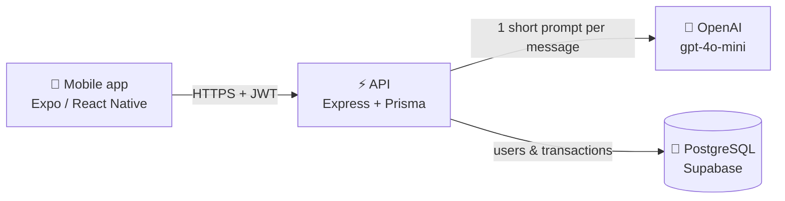

<div align="center">
  

  # Jorge — Finance Assistant

  **Your personal finance assistant: just tell Jorge what you spent.**

  
  
  
  
  

  [Overview](#overview) · [Features](#features) · [Architecture](#architecture) · [Getting started](#getting-started) · [API](#api)

  **English** · [Português](./README.pt-BR.md)
</div>

---

## Overview

Jorge is a mobile app with an AI-powered chat for tracking personal finances. Instead of filling in forms, you write
what happened in plain Portuguese — Jorge understands it, stores it as a transaction and turns it into reports.

```
You:    "gastei 50 reais no mercado"
Jorge:  ✅  gasto · R$ 50,00 · mercado
```

This repository contains the whole product:

| Folder | What it is | Stack | Deployed on |
| --- | --- | --- | --- |
| [`mobile/`](./mobile) | Android app | Expo · React Native · TypeScript | EAS Build (APK) |
| [`backend/`](./backend) | REST API | Node.js · Express · Prisma · PostgreSQL · OpenAI | Railway |

## Screenshots

| Login | Chat | Reports |
| :---: | :---: | :---: |
|  |  |  |

## Features

### Mobile app

- 🔐 **Account & session** — sign up with email, password and phone; the JWT is kept in AsyncStorage so you stay
  logged in, and every request is sent with `Authorization: Bearer <token>`.
- 💬 **Chat with Jorge** — WhatsApp-style conversation with user/bot bubbles, and an animated Jorge that "thinks"
  and "counts" while your message is processed.
- 📶 **Offline queue** — connectivity is watched with NetInfo; messages written offline are stored locally and sent
  automatically when the connection comes back.
- 📊 **Reports** — total for the period, bar chart by category and the latest entries, with a date range filter
  (default: first day of the month → today).
- 👤 **Profile** — view your email, edit your display name and log out.

### API

- 🤖 **Natural language → transaction** — the message is sent to OpenAI with a strict extraction prompt that returns
  `valor` (amount), `tipo` (`gasto` / `receita` / `outro`), `categoria` and `comentario`, which is saved as a transaction.
- 💸 **Cost guards** — messages are limited to 150 characters, with low temperature and a small `max_tokens`.
- 🔑 **Authentication** — signup and login with bcrypt-hashed passwords and JWT; protected routes go through an auth middleware.
- 📅 **Transactions by period** — the user's transactions filtered by date, newest first.
- 📄 **Interactive docs** — Swagger / OpenAPI at `/api-docs`.

## Architecture



What happens when you send a message:

1. The app posts the text to `POST /webhook/messages` (or keeps it in the offline queue if there's no connection).
2. The API validates the token and the message size, then asks OpenAI to extract amount, type and category.
3. The result is saved as a transaction and returned to the app.
4. The Reports screen reads `GET /transactions` for the selected period and groups the values by category.

### Project structure

```
.
├── backend/
│   ├── prisma/
│   │   ├── schema.prisma       data model
│   │   └── migrations/         SQL migrations
│   ├── src/
│   │   ├── routes/             Express routes + OpenAPI annotations
│   │   ├── services/           business logic (chat/OpenAI, auth, users, transactions)
│   │   ├── middlewares/        JWT auth
│   │   ├── lib/prisma.ts       Prisma client
│   │   ├── swagger.ts          Swagger / OpenAPI setup
│   │   └── index.ts            app entry point
│   └── Procfile                Railway start command
│
└── mobile/
    ├── App.tsx                 providers + navigation
    ├── app.config.ts           Expo config (reads API_URL)
    ├── eas.json                build profiles
    └── src/
        ├── pages/              login, register, home (chat), reports, profile
        ├── routes/             stack + bottom tabs
        ├── context/            auth and connectivity
        ├── services/api.ts     axios instance with the auth interceptor
        ├── global/             theme, fonts, token helpers, offline queue
        └── assets/             Jorge illustrations and app icons
```

## Getting started

### Prerequisites

- **Node.js 18+**, **Yarn** (backend) and **npm** (mobile)
- A **PostgreSQL** database (a free Supabase project works) and an **OpenAI API key**
- **Expo Go** on your phone, or an Android emulator
- **EAS CLI** (`npm i -g eas-cli`) only if you want to build the APK

### 1. API

```bash
cd backend
cp .env.example .env            # fill in the variables below
yarn install
npx prisma generate             # generates the Prisma client in src/generated/prisma
npx prisma migrate deploy       # creates the tables
yarn dev                        # http://localhost:3065 — docs at http://localhost:3065/api-docs
```

| Variable | Description |
| --- | --- |
| `PORT` | HTTP port (example: `3065`) |
| `DATABASE_URL` | PostgreSQL connection string used by the app (pooled, on Supabase) |
| `DATABASE_DIRECT_URL` | Direct connection string, used by migrations |
| `OPENAI_API_KEY` | OpenAI key |
| `JWT_SECRET` | Secret used to sign tokens |
| `JWT_EXPIRES_IN` | Token lifetime, e.g. `7d` |
| `PRISMA_DISABLE_PREPARED_STATEMENTS` | `true` when using a connection pooler (Supabase) |

### 2. Mobile app

```bash
cd mobile
cp .env.example .env            # API_URL=http://<your-api>
npm install
npm start                       # scan the QR code with Expo Go, or press "a" for Android
```

> [!TIP]
> `localhost` only works on the computer itself. On a physical phone, point `API_URL` to your machine's IP on the
> local network (e.g. `http://192.168.0.10:3065`); on the Android emulator, use `http://10.0.2.2:3065`.

## API

All routes except `/auth/*` and `/serverstatus` require `Authorization: Bearer <token>`.

| Method | Route | Description |
| --- | --- | --- |
| `POST` | `/auth/signup` | Create an account — `{ email, password, phone }` |
| `POST` | `/auth/login` | Log in — `{ email, password }` → `{ token }` |
| `POST` | `/webhook/messages` | Send a message to Jorge and store the transaction |
| `GET` | `/transactions?startDate=YYYY-MM-DD&endDate=YYYY-MM-DD` | Transactions in the period |
| `PATCH` | `/transactions/:id` | Fix a transaction — any of `{ type, amount, category, description, createdAt }` |
| `DELETE` | `/transactions/:id` | Delete a transaction |
| `GET` | `/user/:id` | Get a user profile (including the monthly spending goal) |
| `PUT` | `/user/:id` | Update the display name and/or monthly spending goal — `{ name?, monthlyGoal? }` |
| `GET` | `/serverstatus` | Health check (returns `on`) |

**Example — sending a message**

```http
POST /webhook/messages
Authorization: Bearer eyJhbGciOi...
Content-Type: application/json

{
  "userMessage": {
    "id": "1730000000000",
    "text": "gastei 50 reais no mercado",
    "userPhone": "5511999999999"
  }
}
```

```json
{
  "id": "3f0c2b9e-8a41-4d6e-9f57-1c2d3e4f5a6b",
  "valor": 50,
  "tipo": "gasto",
  "categoria": "Mercado",
  "comentario": ""
}
```

The full, interactive documentation is served by Swagger at **`/api-docs`**:


Prefer Insomnia? Import the ready-made collection: [Insomnia-RequestsFile.yaml](https://github.com/user-attachments/files/24020089/Insomnia-RequestsFile.yaml).
