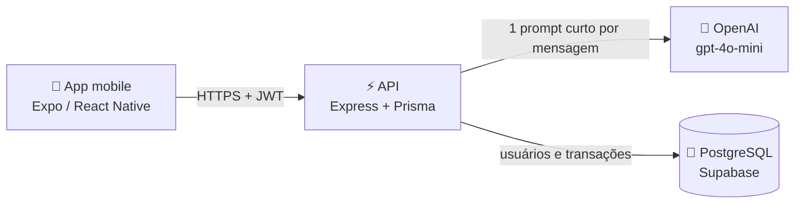

<div align="center">
  

  # Jorge — Assistente Financeiro

  **Seu assistente financeiro pessoal: é só contar pro Jorge o que você gastou.**

  
  
  
  
  

  [Visão geral](#visão-geral) · [Por que o Jorge?](#por-que-o-jorge) · [Funcionalidades](#funcionalidades) · [Arquitetura](#arquitetura) · [Como rodar](#como-rodar) · [API](#api)

  [English](./README.md) · **Português**
</div>

---

## Visão geral

O Jorge é um app mobile com um chat de IA para controlar as finanças pessoais. Em vez de preencher formulários, você
escreve o que aconteceu do jeito que falaria — o Jorge entende, salva como uma transação e transforma tudo em relatórios.

```
Você:   "gastei 50 reais no mercado"
Jorge:  ✅  gasto · R$ 50,00 · mercado
```

Este repositório contém o produto inteiro:

| Pasta | O que é | Stack | Deploy |
| --- | --- | --- | --- |
| [`mobile/`](./mobile) | App Android | Expo · React Native · TypeScript | EAS Build (APK) |
| [`backend/`](./backend) | API REST | Node.js · Express · Prisma · PostgreSQL · OpenAI | Railway |

## Por que o Jorge?

A maioria dos apps de finanças obriga você a abrir um formulário, escolher uma categoria e digitar um valor — para
cada cafezinho. É justamente esse atrito que faz a gente desistir de anotar os gastos depois de duas semanas. Eu
queria algo mais parecido com o jeito que eu já falo sobre dinheiro: mandar uma mensagem, como se fosse para um
amigo, e deixar o app fazer o resto.

O Jorge segue três regras:

- **Escrever é a interface.** Uma frase por lançamento. Sem formulários, sem menus.
- **Barato de manter.** Uma única chamada curta ao `gpt-4o-mini` por mensagem — autenticação, armazenamento e
  relatórios não usam IA.
- **Simples de propósito.** Ele registra o que entrou e o que saiu, por categoria. Não é uma ferramenta de orçamento.

## Telas

| Login | Chat | Relatórios |
| :---: | :---: | :---: |
|  |  |  |

## Funcionalidades

### App mobile

- 🔐 **Conta e sessão** — cadastro com e-mail, senha e telefone; o JWT fica salvo no AsyncStorage para manter você
  logado, e toda requisição vai com `Authorization: Bearer <token>`.
- 💬 **Chat com o Jorge** — conversa no estilo WhatsApp, com balões de usuário e do bot, e um Jorge animado que
  "pensa" e "conta" enquanto a mensagem é processada.
- 📶 **Fila offline** — a conexão é monitorada com NetInfo; mensagens escritas sem internet ficam salvas no aparelho
  e são enviadas automaticamente quando a conexão volta.
- 📊 **Relatórios** — total do período, gráfico de barras por categoria e últimos lançamentos, com filtro de datas
  (padrão: primeiro dia do mês → hoje).
- 👤 **Perfil** — veja seu e-mail, edite seu nome e saia da conta.

### API

- 🤖 **Linguagem natural → transação** — a mensagem vai para a OpenAI com um prompt de extração rígido que devolve
  `valor`, `tipo` (`gasto` / `receita` / `outro`), `categoria` e `comentario`, salvos como uma transação.
- 💸 **Controle de custo** — mensagens limitadas a 150 caracteres, temperatura baixa e `max_tokens` pequeno.
- 🔑 **Autenticação** — cadastro e login com senha em hash (bcrypt) e JWT; rotas protegidas passam por um middleware de auth.
- 📅 **Transações por período** — as transações do usuário filtradas por data, das mais recentes para as mais antigas.
- 📄 **Documentação interativa** — Swagger / OpenAPI em `/api-docs`.

## Arquitetura



O que acontece quando você envia uma mensagem:

1. O app envia o texto para `POST /webhook/messages` (ou guarda na fila offline, se estiver sem conexão).
2. A API valida o token e o tamanho da mensagem e pede à OpenAI para extrair valor, tipo e categoria.
3. O resultado é salvo como uma transação e devolvido ao app.
4. A tela de Relatórios lê `GET /transactions` no período escolhido e agrupa os valores por categoria.

### Estrutura do projeto

```
.
├── backend/
│   ├── prisma/
│   │   ├── schema.prisma       modelo de dados
│   │   └── migrations/         migrations SQL
│   ├── src/
│   │   ├── routes/             rotas Express + anotações OpenAPI
│   │   ├── services/           regras de negócio (chat/OpenAI, auth, usuários, transações)
│   │   ├── middlewares/        autenticação JWT
│   │   ├── lib/prisma.ts       client do Prisma
│   │   ├── swagger.ts          configuração do Swagger / OpenAPI
│   │   └── index.ts            ponto de entrada
│   └── Procfile                comando de start na Railway
│
└── mobile/
    ├── App.tsx                 providers + navegação
    ├── app.config.ts           config do Expo (lê o API_URL)
    ├── eas.json                profiles de build
    └── src/
        ├── pages/              login, cadastro, home (chat), relatórios, perfil
        ├── routes/             stack + abas
        ├── context/            autenticação e conectividade
        ├── services/api.ts     instância do axios com o interceptor de auth
        ├── global/             tema, fontes, helpers de token, fila offline
        └── assets/             ilustrações do Jorge e ícones do app
```

## Como rodar

### Pré-requisitos

- **Node.js 18+**, **Yarn** (backend) e **npm** (mobile)
- Um banco **PostgreSQL** (um projeto gratuito no Supabase serve) e uma **chave da OpenAI**
- **Expo Go** no celular, ou um emulador Android
- **EAS CLI** (`npm i -g eas-cli`), só se quiser gerar o APK

### 1. API

```bash
cd backend
cp .env.example .env            # preencha as variáveis abaixo
yarn install
npx prisma generate             # gera o client do Prisma em src/generated/prisma
npx prisma migrate deploy       # cria as tabelas
yarn dev                        # http://localhost:3065 — docs em http://localhost:3065/api-docs
```

| Variável | Descrição |
| --- | --- |
| `PORT` | Porta HTTP (exemplo: `3065`) |
| `DATABASE_URL` | Conexão PostgreSQL usada pela aplicação (pooler, no Supabase) |
| `DATABASE_DIRECT_URL` | Conexão direta, usada pelas migrations |
| `OPENAI_API_KEY` | Chave da OpenAI |
| `JWT_SECRET` | Segredo usado para assinar os tokens |
| `JWT_EXPIRES_IN` | Validade do token, ex.: `7d` |
| `PRISMA_DISABLE_PREPARED_STATEMENTS` | `true` ao usar um pooler de conexões (Supabase) |

### 2. App mobile

```bash
cd mobile
cp .env.example .env            # API_URL=http://<sua-api>
npm install
npm start                       # leia o QR code com o Expo Go, ou aperte "a" para Android
```

> [!TIP]
> `localhost` só funciona no próprio computador. No celular físico, aponte o `API_URL` para o IP da sua máquina na
> rede local (ex.: `http://192.168.0.10:3065`); no emulador Android, use `http://10.0.2.2:3065`.

## API

Todas as rotas, exceto `/auth/*` e `/serverstatus`, exigem `Authorization: Bearer <token>`.

| Método | Rota | Descrição |
| --- | --- | --- |
| `POST` | `/auth/signup` | Cria uma conta — `{ email, password, phone }` |
| `POST` | `/auth/login` | Faz login — `{ email, password }` → `{ token }` |
| `POST` | `/webhook/messages` | Envia uma mensagem ao Jorge e salva a transação |
| `GET` | `/transactions?startDate=YYYY-MM-DD&endDate=YYYY-MM-DD` | Transações do período |
| `GET` | `/user/:id` | Busca o perfil do usuário |
| `PUT` | `/user/:id` | Atualiza o nome — `{ name }` |
| `GET` | `/serverstatus` | Health check (responde `on`) |

**Exemplo — enviando uma mensagem**

```http
POST /webhook/messages
Authorization: Bearer eyJhbGciOi...
Content-Type: application/json

{
  "userMessage": {
    "id": "1730000000000",
    "text": "gastei 50 reais no mercado",
    "userPhone": "5511999999999"
  }
}
```

```json
{
  "valor": 50,
  "tipo": "gasto",
  "categoria": "mercado",
  "comentario": ""
}
```

A documentação completa e interativa fica no Swagger, em **`/api-docs`**:


Prefere o Insomnia? Importe a coleção pronta: [Insomnia-RequestsFile.yaml](https://github.com/user-attachments/files/24020089/Insomnia-RequestsFile.yaml).
