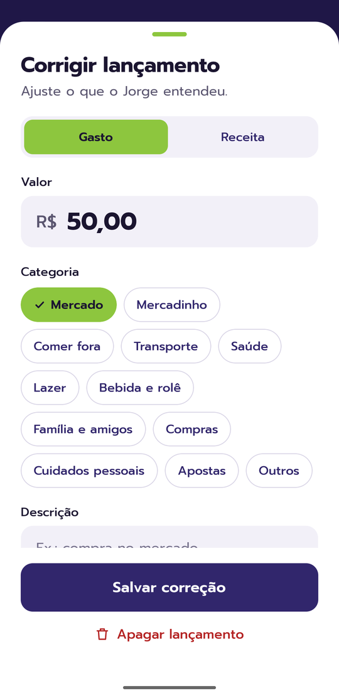
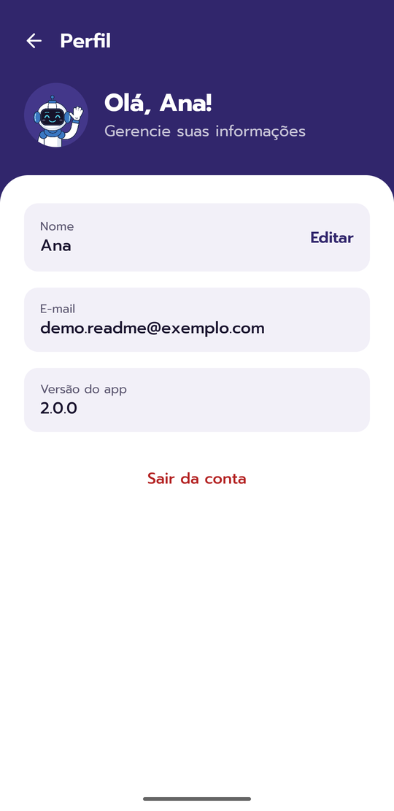
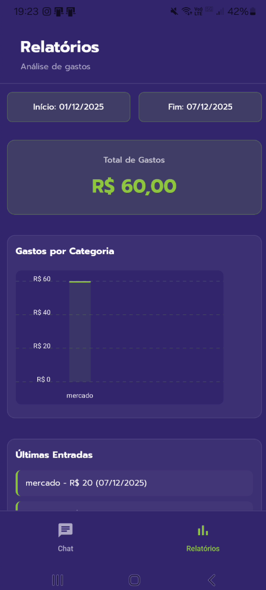
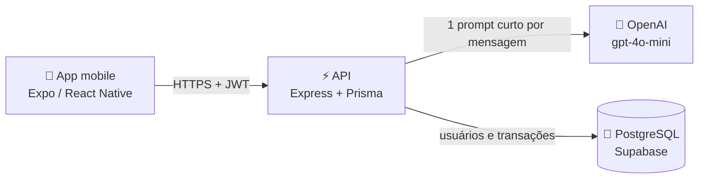

<div align="center">
  <h1>
    <br />
    Jorge — Assistente Financeiro
  </h1>

  **Seu assistente financeiro pessoal: é só contar pro Jorge o que você gastou.**

  

  
  
  
  
  

  [Visão geral](#visão-geral) · [Novidades da v2](#novidades-da-v2) · [Funcionalidades](#funcionalidades) · [Arquitetura](#arquitetura) · [Como rodar](#como-rodar) · [API](#api)

  [English](./README.md) · **Português**
</div>

---

## Visão geral

O Jorge é um app mobile com um chat de IA para controlar as finanças pessoais. Em vez de preencher formulários, você
escreve o que aconteceu do jeito que falaria — o Jorge entende, salva como uma transação e transforma tudo em relatórios.

```
Você:   "gastei 50 reais no mercado"
Jorge:  Entendi assim, confere?   Gasto · R$ 50,00 · Mercado · Hoje   [Confirmar] [Corrigir]
```

> [!NOTE]
> Esta é a **v2 do Jorge**: o app foi redesenhado do zero e ganhou meta mensal de gastos, correção de lançamentos e
> relatórios novos. Veja as [novidades](#novidades-da-v2). Os prints da v1 ficam no fim da seção [Telas](#telas).

Este repositório contém o produto inteiro:

| Pasta | O que é | Stack | Deploy |
| --- | --- | --- | --- |
| [`mobile/`](./mobile) | App Android | Expo · React Native · TypeScript | EAS Build (APK) |
| [`backend/`](./backend) | API REST | Node.js · Express · Prisma · PostgreSQL · OpenAI | Railway |

## Telas

Prints reais da **v2** (conta de demonstração com dados de exemplo).

| Login | Chat | Corrigir lançamento |
| :---: | :---: | :---: |
|  |  |  |

| Relatórios | Ritmo do mês | Detalhe da categoria |
| :---: | :---: | :---: |
|  |  |  |

| Lançamentos | Meta do mês | Perfil |
| :---: | :---: | :---: |
|  |  |  |

<details>
<summary>Telas da v1</summary>

| Login | Chat | Relatórios |
| :---: | :---: | :---: |
|  |  |  |

</details>

## Novidades da v2

- 🎨 **Visual novo** — tema roxo e verde, fonte Prompt, artes novas do Jorge e ícone novo do app (com ícone adaptativo
  e temático no Android). As telas aprovadas do design estão em [`mobile/doc-images/v2/`](./mobile/doc-images/v2).
- ✅ **Confirmar ou corrigir** — depois de cada mensagem o Jorge mostra o que entendeu (tipo, valor, categoria, data)
  com *Confirmar* e *Corrigir*; qualquer lançamento pode ser corrigido ou apagado depois.
- 🎯 **Meta mensal de gastos** — o app acompanha quanto você gastou contra uma meta definida por você, com o ritmo
  comparado ao mês anterior, a projeção para o fim do mês e um aviso quando você está indo passar da meta.
- 📊 **Relatórios novos** — gastos por categoria com a variação sobre o mês anterior, detalhe da categoria nos últimos
  6 meses e a lista de todos os lançamentos com busca e filtro por categoria.
- 🏷️ **Categorias fixas** — o Jorge sempre usa a mesma lista (Mercado, Mercadinho, Comer fora, Transporte, Saúde,
  Lazer, …); as categorias antigas, em texto livre, foram convertidas.
- 💸 **Mesmo custo** — continua uma chamada curta ao `gpt-4o-mini` por mensagem. Resumos, atalhos ("Quanto gastei
  hoje?") e relatórios são calculados no próprio app.

## Funcionalidades

### App mobile

- 🔐 **Conta e sessão** — cadastro com e-mail, senha e telefone; o JWT fica salvo no AsyncStorage para manter você
  logado, e toda requisição vai com `Authorization: Bearer <token>`.
- 💬 **Chat com o Jorge** — resumo do mês com a barra da meta no topo, cartão de confirmar/corrigir a cada lançamento
  novo e atalhos ("Quanto gastei hoje?", "Resumo da semana") respondidos pelo próprio app.
- 📶 **Fila offline** — a conexão é monitorada com NetInfo; mensagens escritas sem internet ficam salvas no aparelho
  e são enviadas automaticamente quando a conexão volta.
- 🎯 **Meta mensal** — defina quanto quer gastar por mês; o app mostra o % usado, quanto resta, o ritmo comparado ao
  mês anterior e a projeção para o fim do mês.
- 📊 **Relatórios** — semana, mês, 3 meses ou ano; gastos por categoria, maiores gastos, detalhe da categoria (últimos
  6 meses) e todos os lançamentos com busca e filtros.
- ✏️ **Correções** — corrija tipo, valor, categoria, descrição ou data de qualquer lançamento, ou apague.
- 👤 **Perfil** — veja seu e-mail, edite seu nome e saia da conta.

### API

- 🤖 **Linguagem natural → transação** — a mensagem vai para a OpenAI com um prompt de extração rígido que devolve
  `valor`, `tipo` (`gasto` / `receita` / `outro`), `categoria` (de uma lista fixa) e `comentario`, salvos como uma
  transação.
- 💸 **Controle de custo** — mensagens limitadas a 150 caracteres, temperatura baixa e `max_tokens` pequeno.
- 🔑 **Autenticação** — cadastro e login com senha em hash (bcrypt) e JWT; rotas protegidas passam por um middleware de auth.
- 📅 **Transações por período** — as transações do usuário filtradas por data, das mais recentes para as mais antigas;
  cada uma pode ser corrigida (`PATCH`) ou apagada (`DELETE`).
- 🎯 **Meta mensal** — guardada no perfil do usuário (`monthlyGoal`).
- 📄 **Documentação interativa** — Swagger / OpenAPI em `/api-docs`.

## Arquitetura



O que acontece quando você envia uma mensagem:

1. O app envia o texto para `POST /webhook/messages` (ou guarda na fila offline, se estiver sem conexão).
2. A API valida o token e o tamanho da mensagem e pede à OpenAI para extrair valor, tipo e categoria.
3. O resultado é salvo como uma transação e devolvido ao app.
4. O chat mostra o cartão de confirmar/corrigir; *Corrigir* envia `PATCH /transactions/:id`.
5. Os relatórios leem `GET /transactions` e fazem todas as contas no app (totais, ritmo, projeção, categorias).

### Estrutura do projeto

```
.
├── backend/
│   ├── prisma/
│   │   ├── schema.prisma       modelo de dados
│   │   └── migrations/         migrations SQL
│   ├── src/
│   │   ├── routes/             rotas Express + anotações OpenAPI
│   │   ├── services/           regras de negócio (chat/OpenAI, auth, usuários, transações)
│   │   ├── middlewares/        autenticação JWT
│   │   ├── lib/prisma.ts       client do Prisma
│   │   ├── swagger.ts          configuração do Swagger / OpenAPI
│   │   └── index.ts            ponto de entrada
│   └── Procfile                comando de start na Railway
│
└── mobile/
    ├── App.tsx                 providers + navegação
    ├── app.config.ts           config do Expo (lê o API_URL)
    ├── eas.json                profiles de build
    └── src/
        ├── pages/              login, cadastro, home (chat), relatórios, detalhe da categoria, lançamentos, perfil
        ├── components/         peças do v2 (avatar, folhas, chips, barra da meta, barra de abas, ícones)
        ├── routes/             stack + abas (+ stack dos relatórios)
        ├── context/            autenticação e conectividade
        ├── hooks/              meta mensal, média de gastos por mês
        ├── services/           axios com o interceptor de auth, transações, usuário
        ├── global/             tema, fontes, categorias, helpers de dinheiro e token, fila offline
        └── assets/             ilustrações do Jorge e ícones do app (v2/)
```

## Como rodar

### Pré-requisitos

- **Node.js 24** (versão em `backend/.node-version`), **Yarn** (backend) e **npm** (mobile)
- Um banco **PostgreSQL** (um projeto gratuito no Supabase serve) e uma **chave da OpenAI**
- **Expo Go** no celular, ou um emulador Android
- **EAS CLI** (`npm i -g eas-cli`), só se quiser gerar o APK

### 1. API

```bash
cd backend
cp .env.example .env            # preencha as variáveis abaixo
yarn install
npx prisma generate             # gera o client do Prisma em src/generated/prisma
npx prisma migrate deploy       # cria as tabelas
yarn dev                        # http://localhost:3065 — docs em http://localhost:3065/api-docs
```

| Variável | Descrição |
| --- | --- |
| `PORT` | Porta HTTP (exemplo: `3065`) |
| `DATABASE_URL` | Conexão PostgreSQL usada pela aplicação (pooler, no Supabase) |
| `DATABASE_DIRECT_URL` | Conexão direta, usada pelas migrations |
| `OPENAI_API_KEY` | Chave da OpenAI |
| `JWT_SECRET` | Segredo usado para assinar os tokens |
| `JWT_EXPIRES_IN` | Validade do token, ex.: `7d` |
| `PRISMA_DISABLE_PREPARED_STATEMENTS` | `true` ao usar um pooler de conexões (Supabase) |

### 2. App mobile

```bash
cd mobile
cp .env.example .env            # API_URL=http://<sua-api>
npm install
npm start                       # leia o QR code com o Expo Go, ou aperte "a" para Android
```

> [!TIP]
> `localhost` só funciona no próprio computador. No celular físico, aponte o `API_URL` para o IP da sua máquina na
> rede local (ex.: `http://192.168.0.10:3065`); no emulador Android, use `http://10.0.2.2:3065`.

## API

Todas as rotas, exceto `/auth/*` e `/serverstatus`, exigem `Authorization: Bearer <token>`.

| Método | Rota | Descrição |
| --- | --- | --- |
| `POST` | `/auth/signup` | Cria uma conta — `{ email, password, phone }` |
| `POST` | `/auth/login` | Faz login — `{ email, password }` → `{ token }` |
| `POST` | `/webhook/messages` | Envia uma mensagem ao Jorge e salva a transação |
| `GET` | `/transactions?startDate=YYYY-MM-DD&endDate=YYYY-MM-DD` | Transações do período |
| `GET` | `/user/:id` | Busca o perfil do usuário |
| `PUT` | `/user/:id` | Atualiza o nome — `{ name }` |
| `GET` | `/serverstatus` | Health check (responde `on`) |

**Exemplo — enviando uma mensagem**

```http
POST /webhook/messages
Authorization: Bearer eyJhbGciOi...
Content-Type: application/json

{
  "userMessage": {
    "id": "1730000000000",
    "text": "gastei 50 reais no mercado",
    "userPhone": "5511999999999"
  }
}
```

```json
{
  "valor": 50,
  "tipo": "gasto",
  "categoria": "mercado",
  "comentario": ""
}
```

A documentação completa e interativa fica no Swagger, em **`/api-docs`**:


Prefere o Insomnia? Importe a coleção pronta: [Insomnia-RequestsFile.yaml](https://github.com/user-attachments/files/24020089/Insomnia-RequestsFile.yaml).
