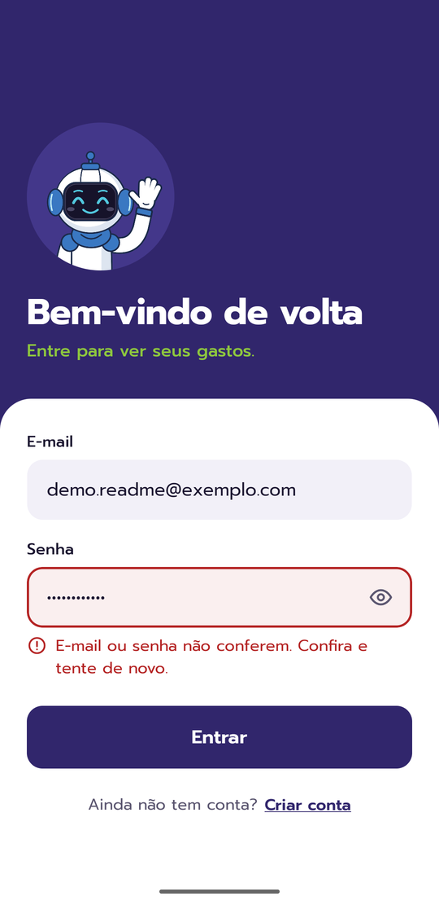
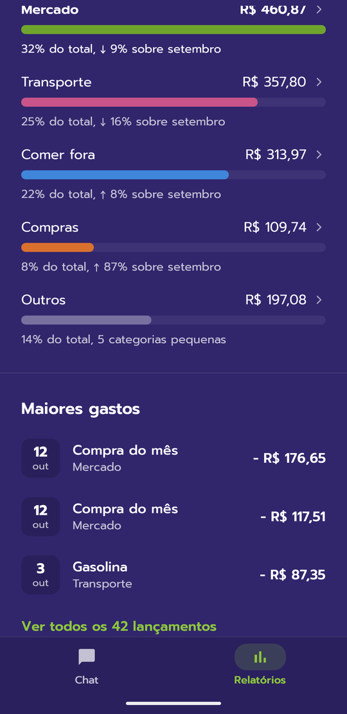

# Jorge — mobile app

Android app of **Jorge**, a personal finance assistant: you type expenses and income in plain language
in a chat screen, the API extracts the data with AI and stores a transaction, and the reports show how much you
spent against a monthly goal. Built with Expo SDK 54, React Native, TypeScript and React Navigation.

This is **v2** (`version` 2.0.0): a full redesign with the confirm/fix card in the chat, the monthly spending goal,
new reports and corrections. See the [screenshots](#screenshots).

This folder is only the app. The API lives in [`../backend`](../backend); the full project overview,
features and API reference are in the [root README](../README.md).

## Running locally

Requirements: Node.js, npm and the API running (see [`../backend`](../backend)).

```bash
npm install
cp .env.example .env   # then set API_URL
npm start              # Expo dev server (Expo Go / dev client)
```

`API_URL` is read by `app.config.ts` and exposed in `extra.API_URL`. On a physical phone use your machine's
LAN IP, not `localhost`; on the Android emulator use `http://10.0.2.2:3065`.

Other commands:

```bash
npm run android        # open on Android
npm test               # Jest (jest-expo): reports math, offline queue, token, goal and form helpers
npm run lint           # ESLint (eslint-config-expo + prettier)
npx tsc --noEmit       # type check
```

## Building the APK

```bash
eas build -p android --profile preview
```

The `preview` profile builds an APK, and its `API_URL` comes from the profile's `env` in `eas.json`.

## Project structure

```
App.tsx                 fonts + AuthProvider > ConnectionProvider > routes
app.config.ts           Expo config (the only one; there is no app.json)
src/
  routes/               stack (Login, Register, MainApp, Profile) and tabs (Chat, Reports), with navigation types
  pages/<screen>/       index.tsx + styles.ts for login, register, home (chat), reports, profile
  components/           v2 building blocks (JorgeAvatar, Sheet, Chip, SegmentedControl, PrimaryButton, GoalBar,
                        TabBar, icons, ...) and the sheets to fix a transaction and set the monthly goal
  hooks/                monthly goal and average monthly spending
  context/              AuthContext (session from the saved JWT), ConectionContext (network status + offline queue)
  global/               theme, fonts, formatCurrency, categories, monthly goal helpers, token check, offline queue
  services/             api.ts (axios with the Bearer token; a 401 logs out), transactions.ts, user.ts
  assets/               Jorge images and app icon
doc-images/             v2/app/: real v2 screenshots used in the READMEs; v2/: approved design screens; v1/: old screenshots
```

Pure logic lives outside the components, with Jest tests in `__tests__/` next to it.

## How it behaves

- **Session:** the JWT is saved in AsyncStorage and restored on launch if it has not expired. There is no
  token refresh: when the token expires (or the API answers 401) you are sent back to the login screen.
- **Chat:** each message is sent to `POST /webhook/messages`; the API turns it into a transaction (already saved)
  and the chat shows a card with what Jorge understood. *Confirmar* just closes it; *Corrigir* opens the sheet that
  sends `PATCH`/`DELETE /transactions/:id`. The month summary and the shortcuts ("Quanto gastei hoje?",
  "Resumo da semana") are calculated in the app, with no AI call.
- **Offline queue:** messages sent without a connection are queued and sent when the connection comes back
  or when the same user logs in again. Messages from another account stay queued. Messages the API rejects
  (e.g. "not a transaction") are dropped; temporary failures keep the item and retry later. Resending is safe
  because the API is idempotent by message `id`.
- **Reports:** week, month, 3 months or year. The month panel shows spending against the monthly goal, the pace
  against last month with an end-of-month projection (and a warning when it goes over the goal), spending by
  category, biggest expenses, a 6-month category detail and the list of all transactions. Only expenses count.
  Dates are sent as `YYYY-MM-DD` in local time.
- **Monthly goal:** saved on the profile (`monthlyGoal`) and valid for every month until you change it.

## Screenshots

Real **v2** screenshots (demo account with sample data). The approved design screens are in
[`doc-images/v2/`](./doc-images/v2) and the v1 screenshots in [`doc-images/v1/`](./doc-images/v1).

| Login | Login error | Chat (thinking) | Chat (confirm) |
| :---: | :---: | :---: | :---: |
|  |  |  |  |

| Fix a transaction | Reports | Spending pace | Categories |
| :---: | :---: | :---: | :---: |
|  |  |  |  |

| Category detail | All transactions | Monthly goal | Profile |
| :---: | :---: | :---: | :---: |
|  |  |  |  |
